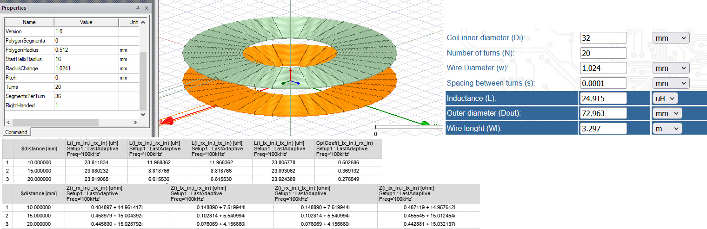
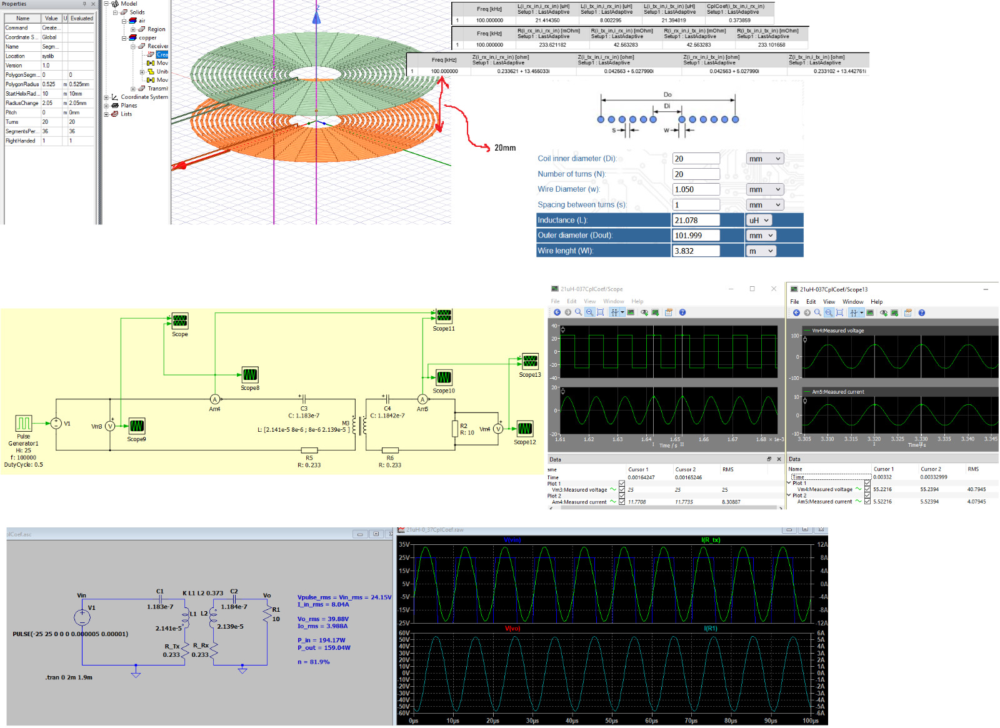
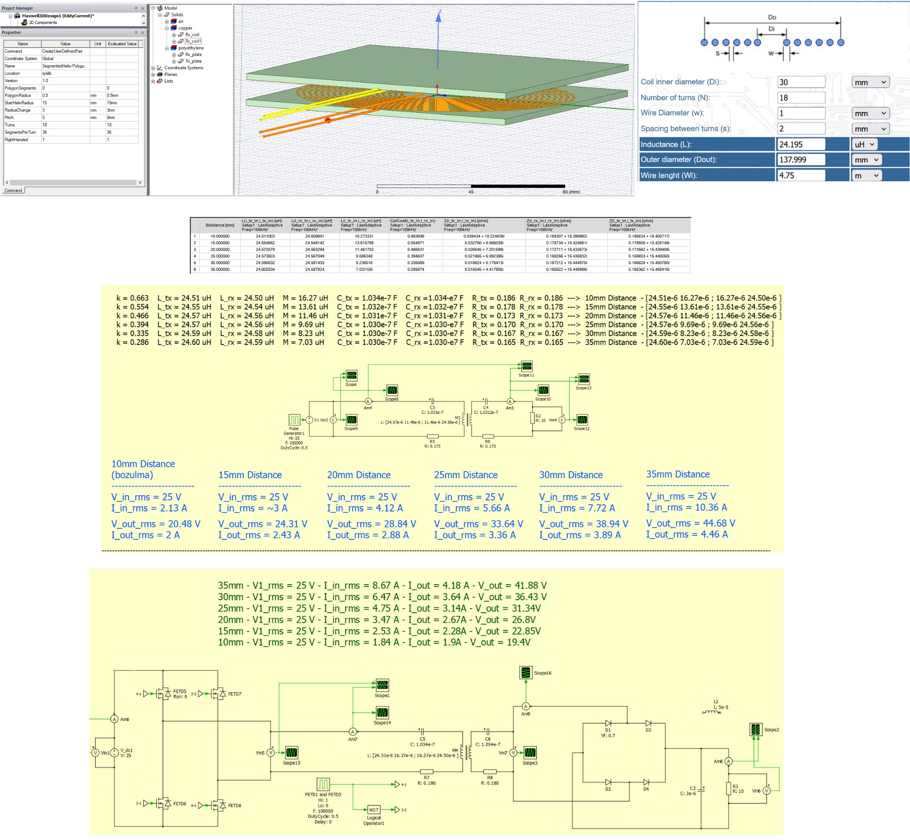
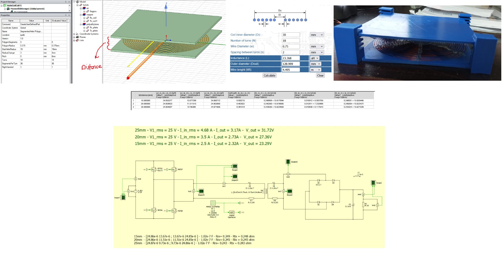
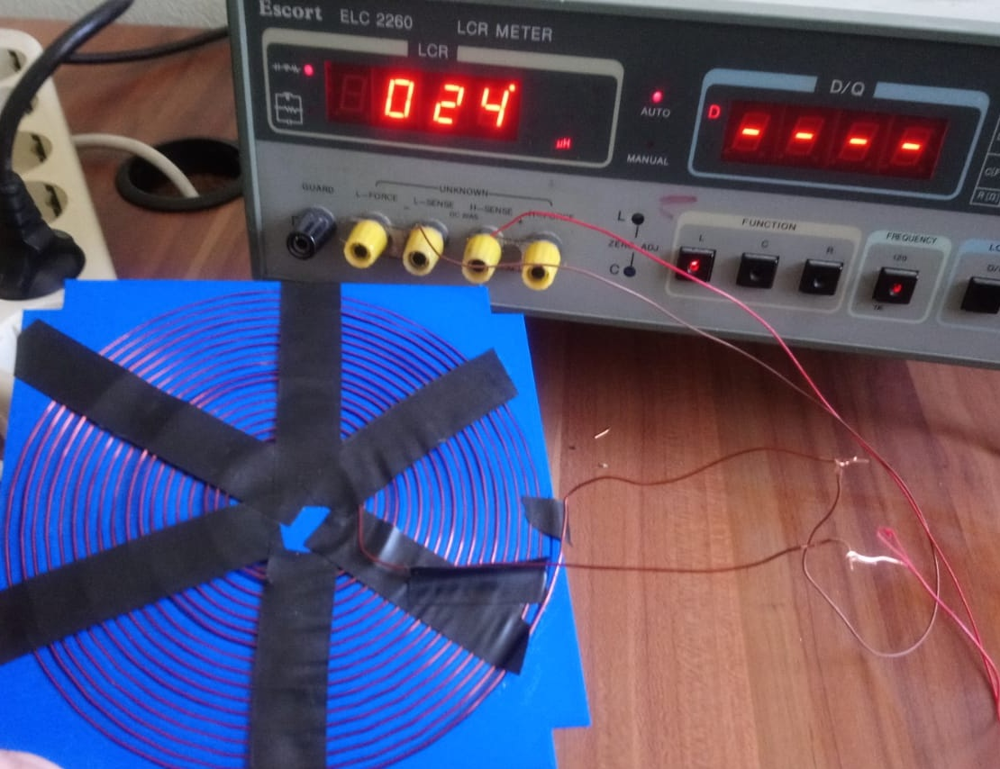
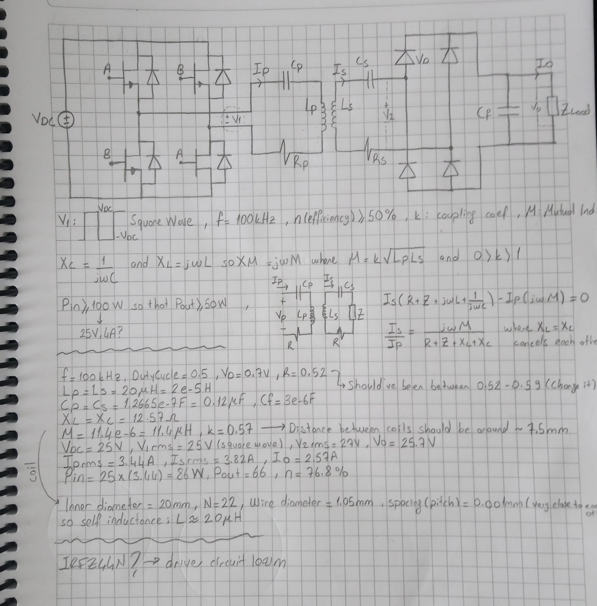

# Coil Design for Wireless Power Transfer

I worked on a Wireless Power Transfer project for graduation thesis and my role was to design and build the tranmitter and receiver coils.
This writing covers my work from inductance calculations to a physical coil, measured about 24 uH.

## 1. Theoretical Calculations

First, I used an online tool for calculating the inductance of a flat spiral coil. I set up the inner diameter, number of turns, wire diameter, and spacing between turns to calculate the inductance.

The image below shows one of the calculations on the right and Ansys coil model on the left. The results were:

| Parameter | Value |
|---|---:|
| Coil inner diameter | 32 mm |
| Number of turns | 20 |
| Wire diameter | 1.024 mm |
| Spacing between turns | About 0.0001 mm |
| Calculated outer diameter | 72.963 mm |
| Calculated wire length | 3.297 m |
| Theoretical inductance | **24.915 µH** |

This step helped me choosing coil dimensions and selecting the values.

## 2. Circuit Simulation with LTspice and PLECS

I used LTspice and PLECS tools to study how the coils behaved in the WPT circuit. In these models, the transmitter and receiver coils were represented by two magnetically coupled inductors.

The comparison below is from a separate test with coils of about 21.4 uH. The main parameters were:

- Operating frequency: **100 kHz**
- Distance between coils: **20 mm**
- Mutual inductance: about **8 µH**
- Coupling coefficient: about **0.374**
- Series resistance of each coil: about **0.233 Ω**
- Resonance capacitors: about **118 nF**
- Load resistance: **10 Ω**

Some of the recorded results were:

| Quantity | PLECS | LTspice |
|---|---:|---:|
| Input voltage, RMS | 25 V | 24.15 V |
| Input current, RMS | 8.31 A | 8.04 A |
| Load voltage, RMS | 40.79 V | 39.88 V |
| Load current, RMS | 4.08 A | 3.99 A |

In this example, the 10 Ω load was connected directly to the receiver's AC circuit. Both simulation tools gave similar voltage and current values. The input voltage was a square wave. The coil currents and load voltage were close to sine waves.

## 3. Coil Simulation with Ansys Maxwell
I built 3D coil models in Ansys Maxwell. I used 100 kHz Eddy Current analysis to find the self-inductance, mutual inductance, coupling coefficient, and equivalent AC resistance of the coils. I then used these parameters in the circuit models.

Another design near the 24 µH target had a 30 mm inner diameter, 18 turns, 1 mm wire diameter, and 2 mm spacing between turns. The online calculator gave 24.195 µH for this design. Maxwell gave about 24.5–24.6 µH.

I also studied how the distance between the coils affected magnetic coupling. As the distance increased, the self-inductance values changed very little. However, the mutual inductance and coupling coefficient decreased.

Another set of simulation notes, saved together with a photo of the physical coil setup, included these results:

| Distance between coils | Mutual inductance, M | Coupling coefficient, k |
|---|---:|---:|
| 15 mm | 13.68 µH | 0.550 |
| 20 mm | 11.51 µH | 0.463 |
| 25 mm | 9.74 µH | 0.392 |

In this model, the self-inductance of each coil was about 24.86 µH. The equivalent AC resistance was about 0.24–0.25 Ω. The series resonance capacitors in the PLECS model were about 102 nF.

## 4. Building and Measuring the Coil
After the simulations, I wound the spiral coils. The photo above shows the two coils facing each other.

I measured the inductance of the coil I built with an LCR meter. The reading in the photo was about 24 µH.

This measurement showed that the physical coil reached the target of about 24 µH. The calculations and simulations helped me check the coil design before building it. The LCR meter then allowed me to check the inductance of the finished coil.

## 5. Project Notes

My handwritten notes also include the general system circuit, a separate design test with about 20 µH coils, and resonance calculations. This page is a working note from a different design test. It is not a measurement record for the physical coil shown above.

In this project, I worked through coil design, electromagnetic simulation, circuit modeling, physical winding, and inductance measurement. The main results of my work were a physical coil with an inductance of about 24 µH and simulation results for different coil designs and distances.
